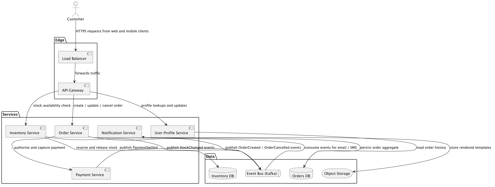
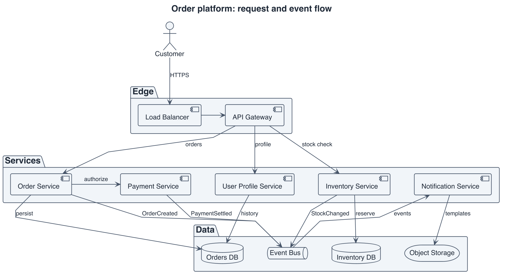
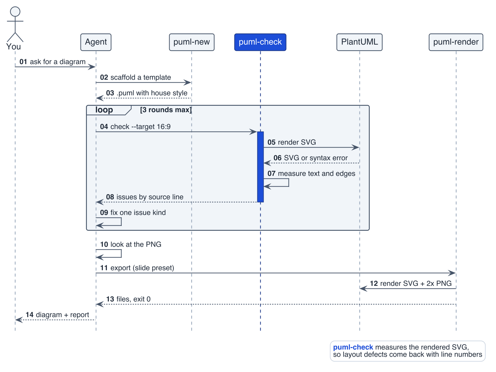

# plantuml-diagrams-skill

**An [Agent Skill](https://agentskills.io) that gets coding agents to draw PlantUML diagrams worth looking at: no
overlapping labels, no squashed text, and a shape that fits a slide or a page.**

[](LICENSE)
[](https://plantuml.com)
[](skills/plantuml-diagrams/scripts)

Works with Claude Code, Codex CLI, opencode, Devin CLI and the Deep Agents CLI: one folder, no harness-specific features.
PlantUML only; Mermaid is planned as a separate skill (see [Roadmap](#roadmap)).

| What agents usually produce | With this skill |
|---|---|
|  |  |
| 2.63:1, 8 crossings, 5 layout warnings | 1.82:1 (16:9 target), 3 crossings, 0 warnings |

*Same 12 components and 14 relationships. Sources and the checker's full report: [`examples/`](examples/).*

## Why

Ask an agent for a PlantUML diagram and it usually renders, but it renders badly: sentence-length labels pile on top of
each other, edges cut through package titles, and the result is a 3:1 strip or a tall ribbon that turns to unreadable
text on a slide. The agent can't see any of this, because a clean exit code says nothing about layout.

This skill closes that loop. It gives the agent rules that prevent the common failures, tested templates to start from,
and a checker that renders the diagram, measures the SVG, and reports each defect with its source line. The agent
fixes what the report says, looks at the PNG itself, and only then exports.

## How it works



*Drawn with the skill itself: [`docs/diagrams/how-it-works.puml`](docs/diagrams/how-it-works.puml) was scaffolded with
`puml-new sequence` and came back clean from `puml-check` on the second round.*

## What's inside

- **`SKILL.md`**: 14 hard rules (label length, banned skinparams, size limits, direction as a measured choice, never
  invent a relationship) and an 8-step workflow: takeaway, inventory, scaffold, check, fix, look, export, report.
- **`puml-new`**: scaffolds one of 13 tested templates with the house style inlined: sequence, activity, component,
  deployment, class, state, use case, ER, network, DFD, C4 context, C4 container and C4 component.
- **`puml-check`**: lints the source, renders the SVG, and measures it. It reports text overlaps, edges through text,
  labels through lifelines, labels on container borders, aspect ratio against a target, text too small once scaled,
  missing strokes, silent PNG cropping, and skinparams that paint warning banners into the image. Output comes as
  text, JSON or `file:line:` (gcc) format.
- **`puml-render`**: exports SVG, PNG and PDF for slides, print or web, with dpi set at export time, no error images,
  and a reliable exit code.
- **`references/`**: layout, labels, sequence, activity, state, ER/class, C4, style, toolchain, domain recipes (including
  AWS with offline icons) and failure-mode notes the agent loads only when needed. Each claim was checked by rendering on PlantUML 1.2026.8.

Everything runs locally. The scripts are Python 3 standard library only.

## Requirements

| Need | Version | Notes |
|---|---|---|
| PlantUML | 1.2026.4 or newer (tested on 1.2026.8) | older builds lack the SVG attributes and error flags the checker reads |
| Graphviz | any recent `dot` (tested on 15.1.1; 2.40+ works) | without it PlantUML silently falls back to an engine that ignores layout hints |
| Java | 11+ | headless is enough |
| Python | 3.6+ | standard library only, no `pip install` |

macOS: `brew install plantuml` installs Graphviz and OpenJDK with it.
Linux: distribution PlantUML packages are usually too old; see [`docs/INSTALL-RHEL.md`](docs/INSTALL-RHEL.md) for the
jar-based install, which applies to other distributions with their own package names.
Windows: not tested yet; WSL is the likely route.

Check the toolchain with `plantuml -testdot`; it should print "Installation seems OK". If you use the jar without a
`plantuml` wrapper, set `PLANTUML_JAR` (and `JAVA_HOME` or `PLANTUML_JAVA` if `java` is not on the PATH).

## Install

**For you, in every project** (symlinks, so `git pull` updates the skill):

```sh
git clone https://github.com/gregodouglas/plantuml-diagrams-skill.git
cd plantuml-diagrams-skill
./install.sh    # links skills/plantuml-diagrams into ~/.claude/skills and ~/.agents/skills, then runs a smoke test
```

**For a team repository**: copy `skills/plantuml-diagrams/` into the repository's `.agents/skills/` (or `.claude/skills/` for
Claude Code) and commit it. A real copy is safer than a symlink for cloud agents.

Where each agent looks:

| Agent | User-level | Project-level | Notes |
|---|---|---|---|
| Claude Code | `~/.claude/skills/` | `.claude/skills/` | |
| Codex CLI | `~/.agents/skills/` | `.agents/skills/` | picks up changes without a restart |
| opencode | `~/.claude/skills/`, `~/.agents/skills/`, `~/.config/opencode/skills/` | `.opencode/skills/` | restart after installing; check with `opencode debug skill` |
| Devin CLI | `~/.agents/skills/` (Windows: `%APPDATA%\devin\skills\`) | `.agents/skills/` | Devin cloud: install the repo as a plugin, or vendor the folder |
| Deep Agents CLI | `~/.agents/skills/` | `.agents/skills/` | read at start-up |

The agent runs `plantuml` and the three scripts in `skills/plantuml-diagrams/scripts/`. To skip the permission prompt each time,
merge a snippet from [`config-snippets/`](config-snippets/) (Claude Code and opencode are provided).

## Use

Ask for a diagram in plain words. The skill triggers on requests to draw, diagram or visualise an architecture, flow,
lifecycle, API interaction, data model or system context, and on any mention of PlantUML, UML or C4. Some examples:

> Draw a sequence diagram of the login flow in `src/auth/` for a 16:9 slide.
>
> Make a C4 container diagram of this repository for the README.
>
> Tidy up `docs/diagrams/billing.puml`: the labels overlap.

The agent states the one takeaway the diagram must prove, inventories the nodes and edges (and splits if there are too
many), scaffolds from a template, runs the checker, fixes the issues it reports (up to three rounds), looks at the PNG,
exports, and reports what it dropped or simplified.

The same tools work by hand:

```sh
S=skills/plantuml-diagrams/scripts
$S/puml-new component docs/diagrams/order-flow.puml --title "Order flow"
$S/puml-check docs/diagrams/order-flow.puml --target 16:9 --png --out docs/diagrams/out
$S/puml-render docs/diagrams/order-flow.puml --preset slide --out docs/diagrams/out
```

`puml-check` exits 0 when clean, 1 when it found issues and 2 on a syntax or render error, so it also works as a CI
gate (`--format gcc` gives editor-clickable `file:line:` output, and `--strict` fails on warnings).

## What we learned about PlantUML

These findings drive the rules. Each was verified on PlantUML 1.2026.8 with Graphviz 15.1.1, and several contradict
common advice:

- Long edge labels and `skinparam linetype ortho` cause most overlaps. `polyline` plus labels of four words or fewer
  fixes most of it.
- `!pragma ratio` only stretches whitespace, and `scale` stops at about 4x. To change the shape, change the graph:
  direction, grid-wrapping, hidden links, or a split.
- `skinparam padding`, `ParticipantPadding` and `handwritten` paint a deprecation banner into the image itself.
- `LineThickness 0` or `LineColor transparent` on `title` or `root` strips every element's border in SVG and PDF, while
  the PNG still looks fine.
- An edge into a nested element crosses its container's title. Link to the container instead, keep titles short, and
  nest at most two levels.
- PlantUML's SVG carries `textLength` and `data-source-line`, so overlaps can be measured exactly without fonts or a
  browser. The checker is built on that.

The details are in [`skills/plantuml-diagrams/references/`](skills/plantuml-diagrams/references/).

## Samples

[`samples/`](samples/) holds twelve diagram families, each in several sizes. Five cover software design for one
invented ticketing system: sequence, ER and class, state machines, C4, and AWS deployment (plain and with AWS icons). They
are drawn only from the source material in [`samples/ticketing-input/`](samples/ticketing-input/), so every box traces
back to a line of schema, code or docs. The other seven cover infrastructure: network perimeter, intranet, VMware,
Kubernetes, CI/CD pipeline, CI/CD toolchain and data-flow diagrams.

Fresh agent sessions built them by following the skill literally as a field test. Each family's `NOTES.md` records what
the skill got wrong, the checker's false positives and misses, and the layout tricks that worked. All systems shown are
invented.

## Privacy

Diagrams often describe systems that should not leave your machine, so the skill renders locally only. It never uses
the public plantuml.com server or remote `!include`; C4 comes from the standard library bundled in the PlantUML jar.
The scripts make no network calls. Your agent's model provider still sees whatever you share with the agent, as with
any other task.

## Repository layout

```
skills/plantuml-diagrams/           the skill: copy or link this folder
  SKILL.md                 rules and workflow the agent follows
  scripts/                 puml-new, puml-check, puml-render
  references/              detail loaded on demand
  assets/templates/        the checked templates puml-new produces
  assets/lib/house.puml    the house style as an include file
examples/                  the before/after above, with the checker report
samples/                   field-test diagram families with notes
tests/run.sh               template, fixture and guard regression tests
docs/                      platform-specific install notes and the diagram above
config-snippets/           permission fragments for Claude Code and opencode
install.sh                 user-level install (symlinks plus a smoke test)
```

## Roadmap

- A companion `mermaid-diagrams` skill in its own repository, for diagrams that live in Markdown on GitHub or GitLab.
  It will need its own checker: Mermaid draws most labels as HTML by default, so measuring them takes a browser.
- CI that runs `tests/run.sh` against a pinned PlantUML.

Known checker gaps from the field tests (crowded multiplicities, bundled edges, long detours) and other open work are
tracked as [issues](https://github.com/gregodouglas/plantuml-diagrams-skill/issues).

## Contributing

Bug reports with a `.puml` that renders badly are the most useful contribution. See [CONTRIBUTING.md](CONTRIBUTING.md)
for the development setup and rules, and [AI_POLICY.md](AI_POLICY.md) for how AI was used to build this and what to
disclose. Report vulnerabilities privately as described in [SECURITY.md](SECURITY.md).

## License

[MIT](LICENSE) © 2026 Gregory Douglas
